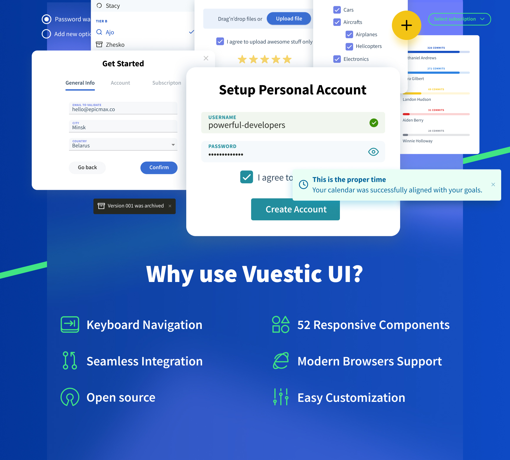
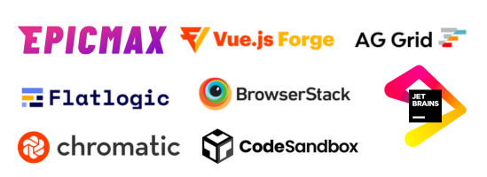

<p align="center">
  <a href="https://vuestic.dev" target="_blank">
      
  </a>
  <br>
  Vue.js 3.0 UI 组件库
  <br>
  由 <a href="https://epicmax.co">Epicmax</a> 开发。
  由 <a href="https://twitter.com/xxsavitski">Vasili Savitski</a> 设计。
  <br>
</p>

<p align="center">
  <a href="https://app.circleci.com/pipelines/github/epicmaxco/vuestic-ui">
    
  </a>
  <a href="https://github.com/epicmaxco/vuestic-ui/blob/develop/LICENSE.MD">
    
  </a>
  <a href="https://www.npmjs.com/package/vuestic-ui">
    
  </a>
</p>

<p align="center">
  <a href="https://github.com/epicmaxco/vuestic-ui/tree/develop/packages/vue-cli-plugin">
    
  </a>
    <a href="https://github.com/epicmaxco/vuestic-ui/tree/develop/packages/vue-cli-plugin">
    
  </a>
  <a href="https://github.com/epicmaxco/vuestic-ui/tree/develop/packages/extensions/ag-grid-theme">
    
  </a>
</p>

<p align="center">
  <a href="https://gurubase.io/g/vuestic-ui">
    
  </a>
</p>

<p align="center">
  <a href="https://vuestic.dev/">文档</a>
  |
  <a href="https://discord.gg/u7fQdqQt8c">Discord</a>
</p>

English | [中文](./README.zh-CN.md)

> Vuestic UI 永远免费且欢迎贡献。查看我们的
<a href="https://github.com/epicmaxco/vuestic-ui/issues">issues</a>、
<a href="https://vuestic.dev/en/contribution/guide">贡献指南</a> 并加入
<a href="https://discord.gg/u7fQdqQt8c">Discord</a> 讨论，帮助我们改进 Vuestic UI。

<p align="center">
  
</p>

### 快速开始

使用以下命令快速创建带有 [Vuestic](https://ui.vuestic.dev) 的新 Vite 或 Nuxt 项目：

```bash
npm create vuestic@latest
```

### 文档

文档、指南、示例和教程请访问 [vuestic.dev](https://vuestic.dev)

### 合作伙伴与赞助商 ❤️



<br />

<a href="https://www.netlify.com">  </a>

感谢 [BrowserStack](https://www.browserstack.com/) 提供基础设施，使我们能够使用所有可能的浏览器进行测试。

感谢 [Chromatic](https://www.chromatic.com/) 提供可视化测试平台，帮助我们审查 UI 更改并防止视觉回归。

成为合作伙伴：[hello@epicmax.co](mailto:hello@epicmax.co)

### 社区

如有任何问题，请通过官方 [Discord 服务器](https://discord.gg/u7fQdqQt8c) 联系我们。

### Vuestic Admin

查看 Vuestic UI 组件库的实际应用。
[Vuestic Admin](https://github.com/epicmaxco/vuestic-admin) 是基于 Vuestic UI 的优秀 Web 应用示例。

### 贡献

感谢所有精彩的 PR、issue 和建议。

<a href="https://github.com/epicmaxco/vuestic-ui/graphs/contributors">
  
</a>
<br />

欢迎加入：查看
<a href="https://vuestic.dev/en/contribution/guide">贡献指南</a>、
[open issues](https://github.com/epicmaxco/vuestic-ui/issues)
和 [Discord 服务器](https://discord.gg/u7fQdqQt8c)

### 雇佣我们

[Epicmax](https://epicmax.co) 从成立之初就致力于开源。
[Vuestic UI](https://vuestic.dev) 由 Epicmax 创建并支持。
您可以通过此 [表单](https://epicmax.co/contacts) 请求咨询或订购 Epicmax 的 Web 开发服务 😎

联系我们：<a href="mailto:hello@epicmax.co">hello@epicmax.co</a>。我们很乐意与您合作！

查看我们的 [其他作品](https://epicmax.co) 🤘

[认识团队](https://ui.vuestic.dev/introduction/team)

### 高级支持与咨询

通过我们的官方开发合作伙伴 Epicmax 获取高级支持与咨询服务。作为 Vuestic UI 和 Vuestic Admin 的主要贡献者，Epicmax 拥有丰富的专业知识和经验，帮助您高效地实现项目目标。

[获取报价](https://www.epicmax.co/?ref=vuestic-consulting)

### 关注我们

获取最新的 Vuestic 新闻！在 [Twitter](https://twitter.com/vuestic_ui)
或 [Linkedin](https://www.linkedin.com/company/18509340) 上关注我们。

### 许可证

[MIT](https://github.com/epicmaxco/vuestic-ui/blob/develop/LICENSE.MD) 许可证。
